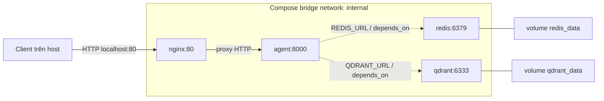
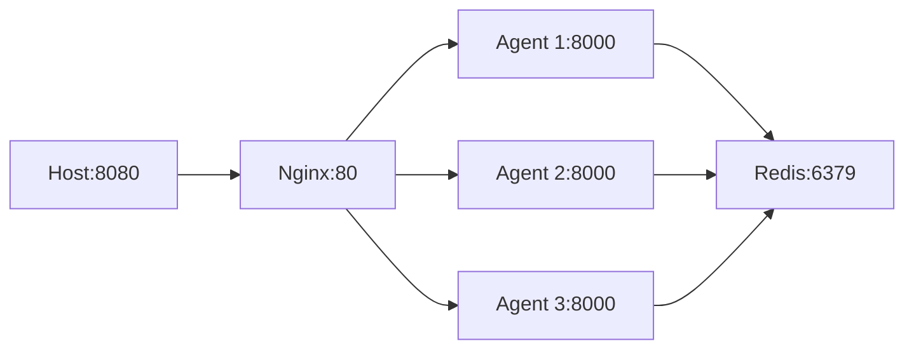

# Day 14 Lab — Mission Answers

## Part 1: Localhost vs Production

Nguồn đối chiếu: `CODE_LAB.md` Exercise 1.1–1.3, phần lưu ý K5 trong `README.md`, và code thực tế trong `01-localhost-vs-production/`.

Môi trường thực hành là Ubuntu WSL2 với môi trường ảo Python. Kết quả kiểm chứng bổ sung và nguồn thực hiện được lưu trong báo cáo và AI log. Bằng chứng đầy đủ: [reports/part1_verification.json](reports/part1_verification.json).

### Exercise 1.1: Phát hiện anti-patterns

**Mục đích:** Nhận ra những cách viết code có thể chạy local nhưng gây khó khăn về bảo mật, cấu hình và vận hành khi triển khai thật.

Đọc `01-localhost-vs-production/develop/app.py` và nhận thấy các vấn đề sau:

| # | Vấn đề trong code | Vì sao bất lợi khi triển khai thật? |
|---|------------------|------------------------------------|
| 1 | `OPENAI_API_KEY` được gán trực tiếp trong mã nguồn. | Nếu dùng key thật và đẩy repository lên công khai, người khác có thể lấy key để sử dụng tài khoản và phát sinh chi phí. Giá trị trong bài là key giả để minh họa. |
| 2 | `DATABASE_URL` chứa thông tin đăng nhập và địa chỉ `localhost` cố định. | Nếu thay bằng thông tin thật sẽ có nguy cơ lộ mật khẩu; khi chạy trong container, `localhost` là chính container, có thể không phải nơi chạy database. |
| 3 | Các cấu hình như `MAX_TOKENS`, `DEBUG` được viết cứng. | Muốn đổi cấu hình giữa dev, staging và production phải sửa code. Riêng biến `DEBUG` chưa điều khiển Uvicorn vì lời gọi bên dưới vẫn ghi `reload=True`. |
| 4 | Dùng `print()` để ghi log và còn in `OPENAI_API_KEY`. | Dễ lộ secret qua log; thiếu cấu trúc, thời gian và mức độ log nhất quán để tìm kiếm lỗi khi vận hành. |
| 5 | Uvicorn nhận `port=8000` cố định. | Không sử dụng được cổng mà nền tảng cloud cấp qua biến `PORT` nếu không sửa code hoặc đổi cách chạy. |
| 6 | Uvicorn bind vào `host="localhost"`. | Chỉ nghe trên loopback; khi đóng gói container, dịch vụ có thể không nhận được kết nối đi vào qua mạng container dù đã publish port. |
| 7 | Bật `reload=True` cố định. | Cơ chế theo dõi thay đổi và nạp lại code hữu ích khi phát triển, nhưng không phù hợp để bật mặc định khi triển khai thật. |
| 8 | Không có endpoint `/health` hoặc `/ready` riêng. | Thiếu giao diện rõ ràng để nền tảng kiểm tra dịch vụ còn sống và đã sẵn sàng nhận traffic hay chưa. |
| 9 | Không có lifecycle hook riêng của ứng dụng để khởi tạo, dọn tài nguyên và cập nhật readiness khi dừng. | Khi bổ sung database, model hoặc request đang xử lý, ứng dụng cần quản lý tài nguyên và quá trình dừng rõ ràng. Uvicorn vẫn có cơ chế shutdown riêng; không thể kết luận bản develop luôn bị tắt đột ngột. |

### Exercise 1.2: Chạy bản develop và quan sát

**Mục đích:** Tự chạy ứng dụng, gọi đúng hợp đồng API và phân biệt việc trả lời được một request với việc đủ điều kiện vận hành production.

#### Cách tự chạy lại trong Ubuntu

Từ thư mục gốc repository:

```bash
source ~/.venvs/day14/bin/activate
cd 01-localhost-vs-production/develop
python -m pip install -r requirements.txt
python app.py
```

Giữ terminal chạy app. Trong terminal Ubuntu thứ hai:

```bash
curl -i -X POST "http://localhost:8000/ask?question=Hello"
```

Lưu ý K5: hàm `ask_agent(question: str)` của bản develop nhận `question` qua query string. Lệnh gửi JSON trong `CODE_LAB.md` không khớp với bản code này và sẽ trả 422.

#### Kết quả đã kiểm chứng

- Môi trường kiểm chứng: Ubuntu WSL2, Python `3.12.3`, `os.name = posix`.
- `POST /ask?question=Hello`: HTTP **200**.
- Body thực nhận trong lần kiểm chứng:

```json
{"answer":"Tôi là AI agent được deploy lên cloud. Câu hỏi của bạn đã được nhận."}
```

Đây là nội dung trả lời của mock LLM chạy local, không phải bằng chứng đã deploy lên cloud. Mock chọn ngẫu nhiên câu trả lời nên lần chạy khác có thể nhận nội dung khác.

Kiểm tra thêm:

```bash
curl -i -X POST "http://localhost:8000/ask" \
  -H "Content-Type: application/json" \
  -d '{"question":"Hello"}'

curl -i "http://localhost:8000/health"
```

| Kiểm tra | Kết quả thực nhận | Giải thích |
|----------|------------------|------------|
| `POST /ask?question=Hello` | 200, có trường `answer` | Đúng cách truyền tham số của bản develop. |
| `POST /ask` chỉ có JSON | 422, báo thiếu `query.question` | JSON body không thay thế cho query parameter mà hàm yêu cầu. |
| `GET /health` | 404, `{"detail":"Not Found"}` | Bản develop chưa khai báo endpoint này. |

**Nhận xét:** App chạy được và trả lời request, nhưng chưa đủ để coi là production-ready vì còn các vấn đề cấu hình, secret, logging và health check ở Exercise 1.1. Lab dùng mock LLM nên không cần API key LLM thật.

Nhấn `Ctrl+C` ở terminal chạy app trước khi chuyển sang bản khác cùng cổng.

### Exercise 1.3: So sánh develop và production

**Mục đích:** Hiểu từng cải tiến về cấu hình, logging, health check và vòng đời ứng dụng giải quyết vấn đề nào của bản develop.

| Feature | Develop | Production | Tại sao quan trọng? |
|---------|---------|------------|---------------------|
| Config | Gán trực tiếp trong `app.py`. | Tập trung trong `config.py`, đọc bằng `os.getenv`; một số giá trị có mặc định và có bước `validate()`. | Đổi cấu hình theo môi trường mà không phải sửa mã nguồn. |
| Secrets | Key và URL database được viết cứng; key còn bị in ra log. | Đọc key từ biến môi trường; luồng xử lý request không in key. | Giảm nguy cơ lộ thông tin nhạy cảm trong repository và log. |
| Host, port | `localhost:8000` cố định trong lời gọi Uvicorn. | Đọc `HOST`, `PORT`; mặc định `0.0.0.0:8000`. | Hỗ trợ mạng container và cổng do nền tảng cloud cấp. |
| Reload | Luôn `reload=True`. | `reload=settings.debug`, mặc định false. | Chỉ dùng tự nạp lại code khi chủ động bật chế độ phát triển. |
| Health check | Không có `/health`; đã kiểm chứng trả 404. | `/health` trả trạng thái, uptime, version, environment và timestamp; đã kiểm chứng trả 200. | Cung cấp endpoint để hệ thống giám sát kiểm tra liveness. |
| Readiness | Không có endpoint riêng. | `/ready` dựa trên cờ `is_ready`, có thể trả 503; đã kiểm chứng trả 200 sau startup. | Giúp hệ thống định tuyến biết lúc nào ứng dụng sẵn sàng. Ví dụ này chưa kiểm tra Redis/database thật. |
| Logging | `print()` và có log key. | Dùng `logging`, có ý định cấu trúc log theo JSON; còn hạn chế trong triển khai thực tế, xem ghi chú bên dưới. | Log có cấu trúc giúp lọc theo event, mức độ và thời gian, nhưng phải kiểm tra định dạng thực nhận. |
| Shutdown | Không có lifecycle cleanup riêng của app; vẫn được Uvicorn quản lý server. | Có `lifespan`, cập nhật readiness và mô phỏng cleanup lúc dừng; dùng cơ chế shutdown của Uvicorn. | Chuẩn bị chỗ đóng kết nối, thu hồi tài nguyên và quản lý vòng đời dịch vụ. |
| Cách nhận câu hỏi | Query string: `POST /ask?question=Hello`. | JSON body: `POST /ask` với `{"question":"Hello"}`. | Client phải dùng đúng hợp đồng API của từng bản. |
| CORS | Không cấu hình middleware riêng. | Có `CORSMiddleware`, origins đọc từ `ALLOWED_ORIGINS`; mặc định cấu hình vẫn là `*`. | Có thể giới hạn các website được trình duyệt cho gọi API; cần đặt origins cụ thể khi triển khai thật. |

#### Cách tự chạy bản production

Sau khi dừng bản develop, từ thư mục `develop/` chạy:

```bash
cd ../production
python -m pip install -r requirements.txt
HOST=0.0.0.0 PORT=8000 DEBUG=false ENVIRONMENT=development python app.py
```

Trong terminal khác:

```bash
curl -i "http://localhost:8000/health"
curl -i "http://localhost:8000/ready"
curl -i -X POST "http://localhost:8000/ask" \
  -H "Content-Type: application/json" \
  -d '{"question":"Hello"}'
```

**Lưu ý về `.env`:** `config.py` hiện đọc biến môi trường bằng `os.getenv`, còn `app.py` không gọi `load_dotenv()`. Vì vậy, chỉ copy `.env.example` thành `.env` rồi chạy `python app.py` chưa làm nội dung file tự được nạp. Lệnh trên đặt trực tiếp các biến cần dùng. Đây là thư mục tên `production`, nhưng lần chạy minh họa dùng `ENVIRONMENT=development`; nếu đặt `ENVIRONMENT=production`, bước validation còn yêu cầu `AGENT_API_KEY`.

#### Kết quả kiểm chứng bổ sung của bản production

Phiên kiểm chứng chạy `python app.py` với `HOST=127.0.0.1`, `PORT=18001`, `DEBUG=false`, `ENVIRONMENT=development`. Cổng riêng giúp phân biệt hai app; không sửa code mẫu.

| Kiểm tra trên cổng 18001 | Kết quả thực nhận |
|-------------------------|------------------|
| `GET /` | 200, `app="AI Agent"`, `environment="development"`. |
| `GET /health` | 200, `status="ok"`. |
| `GET /ready` | 200, `ready=true`. |
| `POST /ask` với JSON | 200, có `question`, `answer`, `model`. |

Hai tiến trình kiểm chứng đều thoát với exit code 0 sau SIGTERM. Lần kiểm chứng này **không gửi SIGTERM trong lúc có request đang chạy**, nên chưa chứng minh được khả năng hoàn tất request đang xử lý.

**Giới hạn của code mẫu:**

- Logging chưa bảo đảm JSON hợp lệ. Khi thiếu key LLM, `settings.validate()` gọi `logging.warning()` trước `logging.basicConfig()` của app; lần chạy thực tế ghi nhận dòng `WARNING:root:OPENAI_API_KEY not set — using mock LLM`. Ngoài ra, chèn một chuỗi `json.dumps(...)` vào trường `msg` bằng format string không tự escape dấu ngoặc kép. Vì vậy không nên ghi rằng mọi dòng log đã là JSON chuẩn.
- Việc đọc hoặc yêu cầu `AGENT_API_KEY` trong config chưa đồng nghĩa endpoint `/ask` đã kiểm tra header xác thực. Bản Part 1 chưa triển khai đầy đủ bảo mật của các phần sau.
- Bản production minh họa cách cải thiện cấu trúc ứng dụng, chưa thay thế bài xây agent production-ready ở Part 6.

### Câu hỏi thảo luận trong README Part 1

1. **Nếu push API key thật lên GitHub public thì sao?** Người khác có thể lấy key và sử dụng tài khoản trái phép. Cần thu hồi hoặc đổi key ngay, xử lý thông tin đã lộ trong lịch sử Git và không tiếp tục dùng key cũ; chỉ xóa dòng ở commit mới là chưa đủ.
2. **Vì sao stateless quan trọng khi scale?** Nếu session, bộ đếm hoặc trạng thái cần dùng chung chỉ nằm trong bộ nhớ một process, request sang replica khác có thể mất hoặc sai trạng thái. Lưu trạng thái cần chia sẻ trong dịch vụ ngoài như Redis/database giúp các replica hoạt động nhất quán và dễ thay thế khi restart.
3. **Dev/prod parity nghĩa là gì?** Giữ môi trường phát triển và production gần nhau về phiên bản runtime, dependencies, cách cấu hình và dịch vụ phụ thuộc để giảm lỗi chỉ xuất hiện sau deploy. Secret và giá trị cấu hình cụ thể vẫn có thể khác nhau giữa các môi trường.

### Tự ôn lại trước khi chuyển sang Part 2

- Giải thích được ít nhất 5 vấn đề trong bảng Exercise 1.1 bằng lời của mình.
- Tự gọi lại API develop bằng query và API production bằng JSON.
- Phân biệt liveness (`/health`) với readiness (`/ready`).
- Giải thích vì sao app trả lời được một request chưa đủ để gọi là production-ready.

## Part 2: Docker Containerization

Nguồn đối chiếu: Exercise 2.1–2.4 trong `CODE_LAB.md`, hướng dẫn K5 trong `README.md`, và các file thực tế trong `02-docker/`. Các số đo và kết quả chạy dưới đây lấy từ phiên kiểm chứng trên Docker Desktop qua Ubuntu WSL2; nguồn thực hiện được ghi trong báo cáo và AI log.

Bằng chứng: [reports/part2_verification.json](reports/part2_verification.json), [log build develop](reports/part2_build_develop.log), [log build advanced](reports/part2_build_advanced.log), [log khởi động Compose](reports/part2_compose_up.log).

### Chuẩn bị trước khi chạy

Mở Ubuntu và về thư mục gốc repository:

```bash
cd /mnt/e/Lab_VinUni/Day14/K5-L3-Day14-LeGiaHung-2A202603713-Deployment-Agent-Benchmark-Observability
```

Docker Desktop phải đang chạy và `docker run --rm hello-world` chạy được. Dừng app Part 1 hoặc container của bài trước nếu đang chiếm cổng 8000. Docker tự cài thư viện bên trong image; không cần kích hoạt môi trường ảo để build hoặc chạy container.

### Exercise 2.1: Đọc Dockerfile cơ bản

**Mục đích:** Hiểu các chỉ thị Dockerfile biến mã nguồn và dependencies thành một image có thể chạy lại được.

1. **Base image là gì?** `FROM python:3.11` chọn image Python 3.11 làm nền cho image của bài. Đây là biến thể đầy đủ, chứa nhiều công cụ và thư viện hệ thống hơn biến thể `slim`. Tag có thể cập nhật nên kích thước phải đo ở lần build thực tế.
2. **Working directory là gì?** `WORKDIR /app` đặt thư mục làm việc bên trong image là `/app`. Các đường dẫn đích tương đối của `COPY` và lệnh chạy sau đó sử dụng thư mục này. Đây không phải thư mục dự án trên máy host.
3. **Tại sao copy `requirements.txt` trước?** Dockerfile copy file dependencies rồi chạy `pip install`, sau đó mới copy source. Khi chỉ sửa source mà requirements và các bước trước không thay đổi, Docker có thể tái sử dụng layer cài thư viện. Nếu copy toàn bộ source trước khi cài, sửa code thường làm phải chạy lại bước cài dependencies. `pip --no-cache-dir` tắt cache tải package của pip, không tắt Docker build cache. Xem [Docker: thứ tự layer và cache](https://docs.docker.com/build/cache/optimize/#order-your-layers).
4. **`CMD` và `ENTRYPOINT` khác nhau thế nào?** `CMD` đặt lệnh hoặc tham số mặc định, có thể bị thay bởi lệnh sau tên image trong `docker run`. `ENTRYPOINT` đặt chương trình chính; với dạng exec, tham số sau tên image thường được nối vào chương trình đó. Có thể thay entrypoint bằng `--entrypoint`. Dockerfile này dùng `CMD ["python", "app.py"]`, nên `docker run --rm my-agent:develop python --version` sẽ chạy kiểm tra Python thay cho app. Xem [Dockerfile reference](https://docs.docker.com/reference/dockerfile/#understand-how-cmd-and-entrypoint-interact).

**Build context:** Phải build từ gốc repository vì `COPY 02-docker/develop/requirements.txt ...` và `COPY utils/mock_llm.py ...` được tính theo build context là dấu `.` cuối lệnh. Tùy chọn `-f` chọn Dockerfile, không đổi build context.

### Exercise 2.2: Build và chạy bản develop

**Mục đích:** Tự build image, chạy container, ánh xạ cổng và xác nhận ứng dụng trong container nhận được request từ host.

Từ gốc repository:

```bash
docker build -f 02-docker/develop/Dockerfile -t my-agent:develop .
docker run -d --name day14-part2-develop -p 127.0.0.1:8000:8000 my-agent:develop
docker logs day14-part2-develop
curl -i http://localhost:8000/health
curl -i -X POST "http://localhost:8000/ask?question=What%20is%20Docker%3F"
docker image ls my-agent
```

`-p 127.0.0.1:8000:8000` ánh xạ cổng 8000 của host vào cổng 8000 trong container và chỉ bind host loopback. `EXPOSE 8000` trong Dockerfile chỉ mô tả cổng ứng dụng, không thay thế `-p`.

**Kết quả kiểm chứng:** `GET /health` trả HTTP 200 với `status="ok"`, `container=true`; `POST /ask?question=What%20is%20Docker%3F` trả HTTP 200. Body thực nhận:

```json
{"answer":"Container là cách đóng gói app để chạy ở mọi nơi. Build once, run anywhere!"}
```

Gửi JSON đơn thuần tới `/ask` trả HTTP 422, báo thiếu `query.question`. Kiểm tra trong container: working directory `/app`, Python `3.11.18`, user `uid=0(root)`. Python trong container được quyết định bởi base image, độc lập với Python 3.12.3 trong môi trường ảo Ubuntu.

Ứng dụng Part 2 develop có `/health`, khác với Part 1 develop. Endpoint `/ask` vẫn nhận `question` qua query; gửi JSON đơn thuần sẽ bị 422.

Để xem thư mục và người dùng bên trong container:

```bash
docker exec day14-part2-develop pwd
docker exec day14-part2-develop id
```

Khi kiểm tra xong:

```bash
docker stop day14-part2-develop
docker rm day14-part2-develop
```

### Exercise 2.3: Multi-stage build và so sánh kích thước

**Mục đích:** Hiểu cách tách công cụ build khỏi môi trường chạy và dùng số đo thực tế để đánh giá mức giảm kích thước image.

**Stage 1 — `builder`:** Bắt đầu từ `python:3.11-slim`, cài `gcc` và `libpq-dev`, rồi cài dependencies bằng `pip install --user` vào `/root/.local`. Đây là nơi chuẩn bị thư viện phục vụ runtime.

**Stage 2 — `runtime`:** Bắt đầu lại từ `python:3.11-slim`, tạo `appuser`, copy `/root/.local` của builder sang `/home/appuser/.local`, copy `main.py` và mock utils. Image chạy bằng user không phải root, có `HEALTHCHECK`, và khởi động Uvicorn với hai worker.

**Vì sao nhỏ hơn?** Runtime dùng base `slim` và chỉ nhận các thành phần được copy, không mang toàn bộ hệ thống và build tools của builder sang image cuối. Chênh lệch so với develop đến từ cả việc dùng base nhỏ hơn lẫn việc tách build tools khỏi runtime; không thể quy toàn bộ mức giảm cho riêng multi-stage. Base Python slim vẫn có pip, nên không khẳng định image này hoàn toàn không còn pip. Xem [Docker: multi-stage builds](https://docs.docker.com/build/building/multi-stage/).

Từ gốc repository:

```bash
docker build -f 02-docker/production/Dockerfile -t my-agent:advanced .
docker image ls my-agent
docker image ls my-agent --format 'table {{.Repository}}\t{{.Tag}}\t{{.Size}}'
```

**Số đo thực tế:**

| Image | `docker image ls` hiển thị | Số byte cùng loại dung lượng với image list | Quy đổi MB |
|-------|---------------------------|---------------------------------------------|------------|
| `my-agent:develop` | 1.67 GB | 1.667.782.656 | 1.667,782656 MB |
| `my-agent:advanced` | 240 MB | 239.817.880 | 239,817880 MB |

Cách tính mức giảm so với develop:

```text
(size_develop - size_advanced) / size_develop × 100%
```

Thay số: `(1.667.782.656 - 239.817.880) / 1.667.782.656 × 100% = 85,62055558%`, làm tròn **85,62%**. Bản advanced nhỏ hơn khoảng **1.427,96 MB** theo cùng phép đo và đạt mục tiêu dưới 500 MB của ví dụ.

Số MB trong bảng được quy đổi từ byte theo `1 MB = 1.000.000 byte`; Docker CLI có thể hiển thị số đã làm tròn. Đây là kích thước image mà Docker báo, không phải lượng dung lượng host sẽ được giải phóng khi xóa tag, vì các image/cache có thể dùng chung layer.

**Đối chiếu cách đo trên máy này:** Docker dùng containerd image store. Giá trị `.Size` của `docker image inspect` thực nhận là 426.320.273 byte và 57.409.053 byte, khác với dung lượng mà `docker image ls` hiển thị. Để số đo và phần trăm trong bài nhất quán với yêu cầu `docker images`, bảng trên dùng trường `Size` từ API chỉ đọc `GET /v1.55/images/json` tương ứng image list, không dùng `.Size` của inspect. Hai loại số được lưu riêng trong [reports/part2_image_sizes.json](reports/part2_image_sizes.json) để tránh nhầm. Không trộn hai phép đo khi tính chênh lệch.

Có thể chạy kiểm tra bản advanced trên cổng 8000 sau khi dừng container develop:

```bash
docker run -d --name day14-part2-advanced -p 127.0.0.1:8000:8000 my-agent:advanced
curl -i http://localhost:8000/health
curl -i -X POST http://localhost:8000/ask \
  -H 'Content-Type: application/json' \
  -d '{"question":"What is Docker?"}'
docker exec day14-part2-advanced id
docker inspect --format '{{.State.Health.Status}}' day14-part2-advanced
docker stop day14-part2-advanced
docker rm day14-part2-advanced
```

Đợi app khởi động trước khi gọi API. Health status có thể là `starting` lúc vừa chạy; đợi probe chạy rồi kiểm tra lại.

**Kết quả kiểm chứng:** `/health` và `/ask` với JSON đều trả HTTP 200; `/health` có `version="2.0.0"`. Docker báo container `healthy`. Lệnh `id` trong container trả `uid=999(appuser) gid=999(appuser) groups=999(appuser)`, xác nhận runtime không chạy bằng root. Python trong container là `3.11.18`.

### Exercise 2.4: Docker Compose stack

**Mục đích:** Hiểu cách khai báo, khởi động và debug nhiều dịch vụ có liên quan, cùng mạng, dependency và volume của chúng.

#### Các service và cách giao tiếp

| Service | Vai trò và địa chỉ trong mạng Compose | Lưu trữ / cổng host |
|---------|---------------------------------------|---------------------|
| `nginx` | Reverse proxy HTTP tới `agent:8000`; có cấu hình giới hạn 10 request/giây theo IP và burst 20 cho route thông thường. | Publish `80:80` và `443:443`; mount `./nginx/nginx.conf` chỉ đọc. File hiện chỉ cấu hình listen 80, chưa có TLS cho 443. |
| `agent` | Chạy FastAPI bằng Uvicorn; nhận request từ Nginx. Có `REDIS_URL=redis://redis:6379/0` và `QDRANT_URL=http://qdrant:6333`. | Không publish cổng 8000 trực tiếp ra host trong Compose. |
| `redis` | Dịch vụ key-value tại `redis:6379`; healthcheck bằng `redis-cli ping`. | Named volume `redis_data` mount vào `/data`. Việc mount volume không tự bảo đảm mọi dữ liệu đều được persist; còn tùy cấu hình Redis. |
| `qdrant` | Vector database tại `qdrant:6333`; healthcheck kiểm tra cổng TCP 6333. | Named volume `qdrant_data` mount vào `/qdrant/storage`. |

Các service cùng tham gia bridge network `internal`, được Compose phân giải bằng tên service thay vì phải ghi IP container. Chẳng hạn Nginx dùng `agent:8000`, không dùng `localhost:8000` để gọi agent. Xem [Docker: networking trong Compose](https://docs.docker.com/compose/how-tos/networking/).



Mũi tên nét đứt thể hiện cấu hình và quan hệ phụ thuộc. `main.py` hiện gọi mock LLM, chưa có code đọc/ghi Redis hay tìm kiếm Qdrant; không coi khai báo URL là bằng chứng app đã sử dụng hai dịch vụ này.

`agent` đợi Redis và Qdrant healthy trước khi start. Nginx phụ thuộc agent nhưng `depends_on` dạng danh sách chỉ đợi container agent start, không đợi app healthy, nên gọi quá sớm có thể gặp 502. Comment nói “2 replicas” nhưng Compose chưa đặt số replica; mặc định có một container agent, bên trong có hai worker Uvicorn.

#### Cách chạy lại

Từ gốc repository, dùng một tên project riêng nhất quán cho mọi lệnh:

```bash
cd 02-docker/production
touch .env.local
docker compose -p k5-day14-docker up -d --build
docker compose -p k5-day14-docker ps
```

`.env.local` trống là đủ cho bài dùng mock LLM. Không đưa file này vào Git.

Khi các service đã khởi động và agent sẵn sàng:

```bash
curl -i http://localhost/health
curl -i http://localhost/ready
curl -i -X POST http://localhost/ask \
  -H 'Content-Type: application/json' \
  -d '{"question":"Explain microservices"}'
```

**Kết quả kiểm chứng qua Nginx:**

| Request trên cổng 80 | HTTP | Nội dung chính thực nhận |
|---------------------|------|--------------------------|
| `GET /` | 200 | `app="AI Agent"`, `version="2.0.0"`, `environment="staging"`. |
| `GET /health` | 200 | `status="ok"`, `version="2.0.0"`. |
| `GET /ready` | 200 | `{"ready":true}`. |
| `POST /ask` với JSON `{"question":"Explain microservices"}` | 200 | `{"answer":"Tôi là AI agent được deploy lên cloud. Câu hỏi của bạn đã được nhận."}`. |

Câu trả lời cuối là nội dung ngẫu nhiên của mock LLM đang chạy local, không chứng minh đã deploy lên cloud.

Trước khi dừng stack, `docker compose ps` ghi nhận đúng một container cho mỗi service: agent, Redis và Qdrant đều `healthy`; Nginx `running` và không có healthcheck riêng. Kiểm tra `nginx -t` thành công. Từ bên trong agent, kiểm tra bổ sung phân giải được tên `redis`, `qdrant`, nhận `+PONG` từ Redis và HTTP 200 từ Qdrant. Đây là kiểm tra kết nối chủ động bằng lệnh debug, không phải bằng chứng code mock tự dùng Redis/Qdrant.

Network thực nhận là `k5-day14-docker_internal`, driver `bridge`, chứa bốn container của stack. Sau khi thu thập kết quả, đã dừng và gỡ các container kiểm chứng cùng network của project; giữ lại image và named volumes để chạy lại.

#### Debug và dọn stack sau bài

Chạy trong `02-docker/production/`:

```bash
docker compose -p k5-day14-docker logs --tail=50 agent nginx
docker compose -p k5-day14-docker exec agent sh
```

Trong shell container có thể dùng `pwd`, `id`, `ls /app`; gõ `exit` để trở về Ubuntu. Xem trạng thái rồi dừng stack bằng cùng tên project:

```bash
docker compose -p k5-day14-docker ps
docker compose -p k5-day14-docker down
```

`down` gỡ container và network của project, giữ named volumes. Chỉ thêm `-v` nếu chủ động muốn xóa dữ liệu volume của chính bài này.

**Lưu ý về healthcheck:** Healthcheck đánh dấu container `healthy` hoặc `unhealthy`; bản thân nó không tự restart container. Chính sách `restart: unless-stopped` trong Compose xử lý khi process/container thoát. Vì vậy comment “Docker sẽ tự restart nếu healthcheck fail” trong Dockerfile không mô tả đúng cơ chế này. Xem [Docker: restart policies](https://docs.docker.com/engine/containers/start-containers-automatically/).

### Câu hỏi thảo luận trong README Part 2

1. **Vì sao copy requirements trước source?** Để layer cài dependencies được tái sử dụng khi chỉ source thay đổi, giúp build lại nhanh hơn. Chỉ khi requirements hoặc các bước liên quan trước đó thay đổi mới cần cài lại dependencies.
2. **`.dockerignore` nên chứa gì?** Loại `venv/`, `.venv/`, `__pycache__/`, `*.pyc`, `.git/`, file IDE và secret `.env`, `.env.*`; có thể giữ `.env.example` không chứa secret thật. Môi trường ảo host có thể sai OS/đường dẫn, rất lớn và không cần vì image tự cài thư viện. Secret không nên đi vào build context hoặc image. Với hai lệnh build bài này, Docker đọc `.dockerignore` ở gốc build context của repository.
3. **Nếu agent cần đọc file trên disk, mount thế nào?** Ví dụ dưới đây mount thư mục `data/` của thư mục hiện tại vào `/app/data` trong container, chỉ đọc. Tạo và đặt file dữ liệu vào `data/` trước khi chạy:

   ```bash
   mkdir -p data
   docker run --rm -p 127.0.0.1:8000:8000 \
     --mount type=bind,source="$(pwd)/data",target=/app/data,readonly \
     my-agent:advanced
   ```

   Code trong container đọc file bằng đường dẫn `/app/data/...`. Đây là ví dụ cách mount, chưa được tính là kết quả kiểm thử trong report Part 2.

### Tự ôn lại trước khi chuyển sang Part 4 theo lộ trình K5

- Giải thích được base image, build context, layer cache và sự khác nhau giữa image/container.
- Tự build, gọi API và xem log của ít nhất một container.
- Tự đọc kích thước hai image và tính lại phần trăm chênh lệch.
- Chỉ ra luồng host → Nginx → agent, phân biệt port nội bộ và port publish.
- Biết tên service dùng cho DNS, vai trò của volume, và cách dùng cùng `-p` khi dừng Compose.

## Part 3: Cloud Deployment

**Tình trạng thực hành:** Chưa có triển khai cloud được xác nhận bằng URL public hoặc kết quả kiểm tra dịch vụ từ Internet. Phần so sánh và pipeline dưới đây được hoàn thiện bằng cách đọc cấu hình trong repository.

Theo lộ trình K5, Part 3 thuộc CP6: hoàn thành Part 6 trước, rồi deploy agent trong `06-lab-complete/`. Chọn Railway hoặc Render làm nền tảng chính; nền tảng còn lại có thể làm bài so sánh để đáp ứng rubric. Part 6 đã đạt PASS 12/12; cấu hình Railway/Render đã hoàn thiện. Hướng dẫn thao tác nằm trong [DEPLOYMENT.md](DEPLOYMENT.md).

### Exercise 3.1: Deploy Railway

**Mục đích:** Đưa agent Part 6 lên cloud, cấu hình Redis/biến môi trường và xác nhận API hoạt động qua URL public.

Quy trình triển khai sau khi hoàn thành Part 6:

1. Kiểm tra agent local bằng `python check_production_ready.py` trong Ubuntu, có Docker, và sửa các tiêu chí chưa đạt.
2. Dùng `06-lab-complete/railway.toml` đã hoàn thiện: build bằng Dockerfile, health check `/health`; ứng dụng bind `0.0.0.0` và đọc `PORT`.
3. Chuẩn bị Node.js/npm, cài Railway CLI, đăng nhập và tạo/liên kết project. Tạo service ứng dụng tên `agent` và chọn đúng service trước khi deploy.
4. Tạo Redis trong cùng project. Trong Variables của agent, tham chiếu `REDIS_URL` từ service Redis; không dùng địa chỉ Redis local.
5. Đặt `AGENT_API_KEY`, `ENVIRONMENT` và các biến rate limit/ngân sách mà code sử dụng. Không ghi giá trị secret vào Git hoặc bài nộp.
6. Chạy deploy từ đúng thư mục, đọc log và tạo domain:

```bash
cd /mnt/e/Lab_VinUni/Day14/K5-L3-Day14-LeGiaHung-2A202603713-Deployment-Agent-Benchmark-Observability/06-lab-complete
railway status
railway up . --path-as-root --service agent
railway domain
```

Cài CLI bằng `npm i -g @railway/cli`, đăng nhập bằng `railway login` hoặc `railway login --browserless`; tạo project bằng `railway init`, liên kết service bằng `railway link`. Tài liệu: [Railway CLI](https://docs.railway.com/cli), [railway up](https://docs.railway.com/cli/up), [Railway Redis](https://docs.railway.com/databases/redis).

**Kết quả hiện có:** Chưa có bằng chứng triển khai Railway để ghi tên project, URL, ảnh dashboard hoặc kết quả HTTP cloud.

### Exercise 3.2: Render và so sánh cấu hình

**Mục đích:** Hiểu cách khai báo hạ tầng bằng Blueprint và so sánh cách cấu hình build, runtime, health check, secret giữa hai nền tảng.

Bảng đối chiếu hai file mẫu trong `03-cloud-deployment/`:

| Nội dung | `railway/railway.toml` | `render/render.yaml` | Ý nghĩa |
|----------|----------------------|----------------------|---------|
| Định dạng, phạm vi | TOML, có các nhóm `[build]`, `[deploy]` cho service. | YAML, có danh sách `services` gồm web và Redis. | Render Blueprint mẫu mô tả nhiều tài nguyên; cấu hình Railway mẫu tập trung vào service ứng dụng. |
| Build | Mẫu ghi `builder = "NIXPACKS"`. | Mẫu dùng `runtime: python` và `buildCommand: pip install -r requirements.txt`. | Đây là cấu hình của app mẫu; agent Part 6 cần cách build Docker theo hợp đồng của lab. |
| Start | `uvicorn app:app --host 0.0.0.0 --port $PORT`. | `startCommand` cũng chạy `uvicorn app:app` với `$PORT`. | Khi dùng agent Part 6 cần đúng module `app.main:app` và cấu hình Docker tương ứng. |
| Health check | `healthcheckPath = "/health"`, timeout 30 giây. | `healthCheckPath: /health`. | Cùng mục tiêu kiểm tra dịch vụ nhưng tên trường khác nhau và phân biệt chữ hoa/thường. |
| Secret | File mẫu hướng dẫn đặt qua dashboard/CLI, không chứa key thật. | `sync: false` để nhập ngoài file; `generateValue: true` cho key được sinh tự động. | Tách secret khỏi source và cấu hình công khai. |
| Redis | Không khai báo Redis trong TOML mẫu; tạo service riêng và tham chiếu URL. | Có service `type: redis`, nhưng web chưa được nối bằng biến `REDIS_URL` trong mẫu. | Tạo Redis và nối agent tới Redis là hai bước khác nhau. |
| Tùy chọn vận hành | Có restart policy khi process lỗi. | Có region, plan, autoDeploy trong YAML mẫu. | Cần đọc đúng phạm vi từng cấu hình, không coi tên trường hoặc plan trong mẫu là cam kết hiện hành. |

Nếu chọn Render làm nền tảng chính, dùng `06-lab-complete/render.yaml` đã hoàn thiện, commit/push code không có secret, rồi tạo Blueprint và chọn đúng branch. Đặt **Blueprint Path** là `06-lab-complete/render.yaml`; cấu hình **Root Directory/build context** của web service tương ứng `06-lab-complete/`. Đây là hai thiết lập khác nhau. Tạo Key Value tương thích Redis cùng region và nối URL nội bộ vào `REDIS_URL`. Cấu hình web service dùng Docker, `/health` và các biến cần thiết trước khi deploy.

Tài liệu: [Render Blueprints](https://render.com/docs/infrastructure-as-code), [Blueprint reference](https://render.com/docs/blueprint-spec), [Render Key Value](https://render.com/docs/key-value).

**Kết quả hiện có:** Chưa có bằng chứng triển khai Render. Bảng trên là phân tích file cấu hình, không phải kết quả thử hai nền tảng. Kiểm tra gói/chi phí thực tế trước khi tạo dịch vụ theo `RULES.md`.

### Exercise 3.3: Pipeline Cloud Run

**Mục đích:** Hiểu pipeline kiểm thử, build, push và deploy qua việc đọc `cloudbuild.yaml` và `service.yaml`; theo K5 không cần tài khoản GCP hoặc deploy thực tế.

1. Step `test` dùng Python 3.11 slim, cài requirements và pytest rồi chạy `pytest tests/`.
2. Step `build` phụ thuộc `test`, tạo image với hai tag `$COMMIT_SHA` và `latest`, đồng thời tham chiếu image `latest` để tận dụng cache.
3. Step `push` đẩy các tag tới `gcr.io/$PROJECT_ID/ai-agent`; step `deploy` sau đó chạy `gcloud run deploy` với tag commit trên Cloud Run managed tại `asia-southeast1`.
4. Lệnh deploy mẫu cấu hình CPU, bộ nhớ, timeout, số instance và secret; `service.yaml` mô tả thêm concurrency, port, biến môi trường và các probe. Pipeline hiện dùng lệnh deploy riêng, không tự áp dụng toàn bộ `service.yaml`.
5. Trigger khi push cần được thiết lập trên Cloud Build; comment trong YAML không tự tạo trigger. Đây là phân tích pipeline mẫu, chưa phải xác nhận pipeline đã chạy thành công.

**Điểm cần cải thiện trong mẫu:** Step test chưa bật `set -e` và kết thúc bằng `echo`, nên lỗi từ pip/pytest có thể bị che bởi exit code của lệnh cuối. Khi triển khai thật cần bảo đảm bước test thất bại sẽ chặn bước build. Các tham chiếu registry/nền tảng trong mẫu cũng cần đối chiếu tài liệu hiện hành trước khi chạy.

### Câu hỏi thảo luận Part 3

1. **Vì sao serverless không luôn phù hợp?** Agent có thể cần khởi tạo model lâu, giữ kết nối hoặc xử lý request dài. Cần đối chiếu độ trễ, tài nguyên, timeout và cách quản lý state với đặc điểm workload thay vì chọn chỉ vì tên mô hình triển khai.
2. **Cold start là gì?** Là thời gian khởi tạo instance trước khi phục vụ request đầu, như tải runtime, code, model và thiết lập kết nối. Nó có thể làm request đầu chậm hơn các request sau; giữ instance ấm hoặc giảm thời gian khởi tạo là những cách đánh đổi cần cân nhắc với chi phí.
3. **Khi nào cân nhắc Cloud Run?** Khi ứng dụng cần cách vận hành container, mở rộng và tích hợp hạ tầng phù hợp hơn với yêu cầu thực tế. Quyết định dựa trên tải đo được, độ trễ, tài nguyên, kết nối dịch vụ và khả năng vận hành; không mặc định nền tảng nào luôn tốt hơn.

### Tự kiểm tra sau khi có public URL

Các mã mục tiêu theo CP6 là **200, 200, 401, 200**. Chưa có kết quả thực nghiệm cloud để báo cáo.

```bash
read -r -p 'URL HTTPS cua agent: ' LAB_BASE
LAB_BASE="${LAB_BASE%/}"
read -r -s -p 'AGENT_API_KEY tren cloud: ' LAB_API_KEY
echo
curl -sS -o /dev/null -w '%{http_code}\n' "$LAB_BASE/health"
curl -sS -o /dev/null -w '%{http_code}\n' "$LAB_BASE/ready"
curl -sS -o /dev/null -w '%{http_code}\n' -X POST "$LAB_BASE/ask" \
  -H 'Content-Type: application/json' -d '{"question":"Hello"}'
curl -sS -o /dev/null -w '%{http_code}\n' -X POST "$LAB_BASE/ask" \
  -H 'Content-Type: application/json' -H "X-API-Key: $LAB_API_KEY" \
  -d '{"question":"Hello"}'
unset LAB_API_KEY
```

Khi triển khai xong, bổ sung URL, kết quả thật, ảnh đã che secret và `DEPLOYMENT.md`. Không dùng `GET /ask` để thử auth vì sai method có thể trả 405.

## Part 4: API Security — CP3

Các kết quả thực hành trong phần này là những quan sát đã xác nhận qua trao đổi. Chưa đính kèm transcript headers/body đầy đủ; không tạo lại response giả để thay thế bằng chứng `curl -i`.

### Exercise 4.1: API Key authentication

**Mục đích:** Kiểm tra quyền truy cập trước khi gọi agent, phân biệt thiếu/sai/đúng key và hiểu cách rotate key.

1. **Key được kiểm tra ở đâu?** `APIKeyHeader(name="X-API-Key", auto_error=False)` lấy header. `verify_api_key()` kiểm tra sự hiện diện và so sánh với `API_KEY`; endpoint `/ask` dùng `Depends(verify_api_key)` để yêu cầu kiểm tra này trước khi xử lý nghiệp vụ.
2. **Thiếu/sai key khác nhau thế nào?** Thiếu key trả 401; có key nhưng sai trả 403. Key đúng và JSON hợp lệ cho phép xử lý request. Đây là hành vi của mẫu Part 4, khác hợp đồng Part 6 yêu cầu thiếu hoặc sai key đều 401.
3. **Rotate key thế nào?** Tạo key mới, cập nhật `AGENT_API_KEY` ở môi trường chạy server, restart/redeploy để process nạp giá trị mới và cập nhật key ở client. Mẫu đọc biến khi module được nạp; đổi file hoặc môi trường bên ngoài một process đang chạy không tự thay giá trị đã đọc. Thu hồi key cũ và tránh ghi key thật trong source/log.

| Phép thử đã thực hiện | Kết quả đã báo |
|----------------------|----------------|
| Thiếu `X-API-Key` | 401 |
| Key sai | 403 |
| Key đúng | 200 |

Lệnh khởi động develop dùng trong lab: `AGENT_API_KEY=secret-key-123 python app.py`; đây là key demo, không dùng làm secret thật.

### Exercise 4.2: JWT authentication

**Mục đích:** Hiểu luồng đăng nhập lấy token và xác minh Bearer token khi truy cập endpoint được bảo vệ.

- Client gửi tài khoản demo `student` / `demo123` tới `POST /auth/token`. `authenticate_user()` kiểm tra tài khoản; `create_token()` ký JWT bằng HS256 với `JWT_SECRET`.
- Payload có `sub` nhận diện tài khoản, `role` cho vai trò, `iat` cho thời điểm cấp và `exp` cho thời điểm hết hạn. Token mẫu có hạn 60 phút.
- Client gửi `Authorization: Bearer <token>` khi gọi `/ask`. Dependency `verify_token()` giải mã/xác minh chữ ký và hạn token, rồi trả thông tin tài khoản cho endpoint.
- Thiếu token trả 401, token hết hạn trả 401, token không hợp lệ trả 403 theo code. Chỉ đọc payload không xác minh được chữ ký; JWT được ký không có nghĩa payload được mã hóa để giữ bí mật.

| Phép thử đã thực hiện | Kết quả đã báo |
|----------------------|----------------|
| `/ask` thiếu Bearer token | 401 |
| `/ask` có token vừa lấy | 200 |

Không ghi token vào bài nộp. Việc dùng token thành công ở đây chưa bao gồm thử riêng token hết hạn hoặc token bị sửa.

### Exercise 4.3: Rate limiting

**Mục đích:** Quan sát giới hạn request trong cửa sổ thời gian, response 429 và việc gọi lại sau thời gian chờ.

1. **Thuật toán:** Cửa sổ trượt lưu timestamp từng request bằng `deque` theo user, tương ứng cách làm sliding-window log. Mỗi lần kiểm tra, code xóa timestamp cũ hơn 60 giây, đếm số còn lại rồi quyết định nhận hoặc chặn request; không phải token bucket.
2. **Giới hạn:** User thường là 10 request/60 giây; admin là 100 request/60 giây. Mức áp dụng lấy từ hai instance `RateLimiter`, không phải trường `daily_limit` trong tài khoản demo.
3. **Admin có bypass hoàn toàn không?** Không. Nhánh kiểm tra role trong `app.py` chọn `rate_limiter_admin` thay vì `rate_limiter_user`, tức admin vẫn bị giới hạn nhưng với quota lớn hơn.
4. **State nằm ở đâu?** Các deque nằm trong RAM của process. Restart làm mất bộ đếm; nhiều process/replica có bộ đếm riêng nên không bảo đảm quota dùng chung. Cần kho dữ liệu dùng chung như Redis khi mở rộng.

| Quan sát đã thực hiện | Kết quả đã báo |
|-----------------------|----------------|
| Request đầu tiên bắt đầu bị chặn | Request thứ 11 trả 429 |
| Sau khi đợi theo `Retry-After` | Gọi lại được 200 |

Giá trị số giây của `Retry-After` và response headers/body chưa được lưu, nên không ghi con số chờ cụ thể. Code có các header `Retry-After`, `X-RateLimit-Limit`, `X-RateLimit-Remaining`, `X-RateLimit-Reset` ở nhánh 429.

### Exercise 4.4: Cost guard

**Mục đích:** Theo dõi usage và ngân sách để bảo vệ chi phí, phân biệt với cơ chế giới hạn tốc độ request.

1. **Khác rate limit:** Rate limit giới hạn số request theo thời gian; cost guard giới hạn chi phí/token quy đổi thành tiền. Cùng số request nhưng độ dài input/output có thể khác nhau, nên chỉ rate limit chưa kiểm soát được ngân sách.
2. **Ngân sách và mã lỗi của mẫu:** `CostGuard` được tạo với 1 USD/ngày cho mỗi user và 10 USD/ngày toàn hệ thống. Vượt ngân sách user trả 402; vượt ngân sách chung trả 503 theo code hiện tại. Cảnh báo khi usage user đạt 80% budget. Đây là cấu hình mô phỏng trong repository, không phải chi phí phát sinh thật.
3. **Thứ tự xử lý:** Sau auth và rate limit, app gọi `check_budget(username)`, tiếp theo gọi mock LLM, rồi `record_usage()` để cộng token, số request và chi phí. Kiểm tra hiện tại chỉ so tổng đã dùng với budget, chưa cộng chi phí ước lượng của request sắp chạy, nên chưa bảo đảm một request không làm vượt trần.
4. **Thiết kế 10 USD/tháng với Redis:** Dùng key chứa user và tháng, ví dụ `budget:<user_id>:<YYYY-MM>`, với tháng xác định theo một timezone nhất quán. Lưu tổng tiền hoặc đơn vị tiền nguyên nhỏ; sang tháng dùng key mới, TTL dùng để dọn dữ liệu cũ. Đây là thiết kế mở rộng, chưa phải phần Redis đã triển khai trong mẫu.
5. **Xử lý đồng thời:** Bước đọc số dư, kiểm tra và cập nhật cần nguyên tử, chẳng hạn dùng Redis Lua hoặc transaction có kiểm soát xung đột. Có thể giữ chỗ theo chi phí ước lượng trước request rồi đối soát usage thật sau đó; xử lý hoàn lại phần giữ chỗ nếu request lỗi. Tách `GET` và tăng tiền thành hai lệnh không được bảo vệ có thể cho nhiều request cùng vượt ngân sách.
6. **Reset thực tế:** Record của từng user được thay mới khi `_get_record()` nhận thấy ngày đã đổi. Code dùng `time.strftime` theo timezone hệ thống, nên dòng thông báo “midnight UTC” chưa bảo đảm đúng timezone vận hành. `_global_today` được khởi tạo nhưng không dùng để reset `_global_cost`, vì vậy reset ngân sách chung theo ngày còn thiếu trong mẫu.

**Quan sát đã báo:** Sau một request thành công, `requests` tăng 1 và `cost_usd` tăng. Không có giá trị tuyệt đối trước/sau để ghi số tiền hoặc độ tăng cụ thể. Quan sát này kiểm tra việc ghi nhận usage; chưa thử riêng nhánh hết budget hoặc reset ngày/tháng.

Đọc số dư tại `GET /me/usage`. Trường `budget_remaining_usd` trong response `/ask` đang gán bằng `usage.total_cost_usd`, nên tên trường đó chưa phản ánh số dư đúng. Mẫu lưu usage trong RAM, không phải Redis.

### Câu hỏi thảo luận Part 4

1. **API key, JWT hay OAuth2?** API key phù hợp khi nhận diện client/service đơn giản; JWT là định dạng token có thể mang danh tính/role và hạn dùng để server xác minh. OAuth2 là framework ủy quyền để cấp quyền truy cập theo scope, không phải một loại token đối lập với JWT; OAuth2 có thể dùng JWT làm access token. Khi cần đăng nhập liên kết, dùng cơ chế danh tính phù hợp như OpenID Connect trên OAuth2.
2. **Đặt rate limit bao nhiêu?** Dựa trên khả năng xử lý đo được, độ dài/chi phí request, latency mục tiêu, ngân sách và loại tài khoản. Mức 10/100 request trong mẫu là cấu hình demo, không phải con số tối ưu cho mọi agent.
3. **Key bị lộ thì làm gì?** Theo dõi log/usage bất thường, thu hồi hoặc rotate key, cập nhật server/client và kiểm tra log/lịch sử Git. Không coi xóa dòng secret ở commit mới là đã xử lý việc lộ key cũ.

**Tình trạng CP3:** Các kết quả chức năng 4.1–4.4 đã được báo và phần giải thích đã hoàn thiện theo code. Bài nộp vẫn cần transcript `curl -i` đã che secret, đặc biệt response 429, để có bằng chứng nguyên văn theo checkpoint.

## Part 5: Scaling & Reliability — CP4

### Exercise 5.1: Health check và readiness

**Mục đích:** Phân biệt ứng dụng còn hoạt động với ứng dụng sẵn sàng nhận traffic và đọc đúng phạm vi của các phép kiểm tra.

1. **Liveness và readiness khác nhau thế nào?** Liveness giúp hệ thống có cấu hình probe nhận biết ứng dụng lỗi/treo để quyết định restart. Readiness giúp hệ thống định tuyến tạm ngừng gửi traffic tới instance chưa sẵn sàng mà không nhất thiết restart nó. Một process còn sống có thể vẫn đang khởi tạo hoặc thiếu dependency.
2. **`/ready` develop kiểm tra gì?** Chỉ kiểm tra cờ `_is_ready`. Cờ ban đầu false, thành true sau startup mô phỏng và về false trong phần shutdown của `lifespan`. False trả 503, true trả thông tin ready và số request đang xử lý. Hàm không ping Redis/database.
3. **Vì sao 200 của `/health` chưa đủ?** Endpoint chỉ tính uptime và kiểm tra bộ nhớ bằng `psutil`. Nó vẫn trả HTTP 200 khi body ghi `degraded`; cũng không thử Redis/database hoặc LLM thật. Vì vậy không thể suy ra mọi dependency sẵn sàng từ riêng mã HTTP này.

| Phép thử đã thực hiện | Kết quả đã báo |
|----------------------|----------------|
| `GET /health` | 200 |
| `GET /ready` | 200 |
| `POST /ask?question=Hello` | 200 |

Chưa lưu body chứa uptime/bộ nhớ nên không ghi các giá trị đó. Bản develop nhận query string và mock có độ trễ khoảng 3 giây theo code.

### Exercise 5.2: Graceful shutdown

**Mục đích:** Kiểm tra request đang xử lý có thể hoàn tất và dịch vụ dừng có kiểm soát khi nhận SIGTERM, giảm lỗi khi restart/deploy.

- Uvicorn quản lý việc nhận tín hiệu và quá trình dừng server, có `timeout_graceful_shutdown=30` trong mẫu. Cấu hình này không thay thế việc phải quan sát kết quả request.
- Middleware `track_requests` tăng counter khi nhận request và giảm trong `finally`; `lifespan` thực hiện startup/cleanup, cập nhật readiness và có đoạn chờ counter khi shutdown.
- `_is_ready` được đặt false trong phần cleanup sau `yield`; không mặc định cờ này đổi ngay tại thời điểm gửi SIGTERM. Cần dựa vào thứ tự thực tế của server/lifespan khi mô tả quá trình dừng.
- SIGKILL không cho ứng dụng cơ hội xử lý cleanup, nên không dùng nó để kiểm chứng graceful shutdown.

| Quan sát đã thực hiện | Kết quả đã báo |
|-----------------------|----------------|
| Request khi thử SIGTERM | HTTP 200 |
| Curl exit code | 0 |
| Server | Shutdown xong |

Kết quả phù hợp với việc một request hoàn tất trong phép thử đã chạy. Curl exit code 0 không phải số đo exit code của server. Chưa có PID, thời gian shutdown hoặc transcript log để ghi thêm; cũng chưa thử riêng nhiều request đồng thời hay quan sát `/ready` trả 503 trong lúc dừng.

### Exercise 5.3: Stateless design

**Mục đích:** Tách session/history khỏi RAM riêng của agent để nhiều instance có thể phục vụ cùng cuộc hội thoại.

1. **Chỉ lưu trong dict của từng instance:** A và B có RAM riêng; session lưu ở A không tự xuất hiện ở B. Request chuyển sang B có thể không tìm được history. Restart A cũng làm mất dict của A.
2. **Cách lưu trong code:** `save_session()` ghi JSON bằng Redis `setex`; `load_session()` đọc bằng `get`; `append_to_history()` thêm message rồi lưu lại. Key là `session:{session_id}`, TTL mặc định 3.600 giây được đặt lại sau mỗi lần lưu vào Redis. History giữ 20 message gần nhất, khoảng 10 lượt hỏi–đáp đầy đủ. `session_id` nhận diện cuộc hội thoại; `INSTANCE_ID`/`served_by` nhận diện instance xử lý.
3. **Redis không kết nối được lúc startup:** `USE_REDIS=False`, app chuyển sang `_memory_store` của process. Mỗi instance có dict riêng nên fallback này không bảo đảm history chung khi scale. TTL của Redis không áp dụng cho dict; quyết định fallback ở khối khởi tạo không phải cơ chế tự động khôi phục đầy đủ khi Redis thay đổi trạng thái.
4. **Agent restart và Redis bị dừng/xóa:** Nếu Redis còn giữ key, chưa hết TTL/bị evict thì agent mới đọc lại được session. Dừng Redis làm gián đoạn kết nối; khả năng phục hồi dữ liệu phụ thuộc persistence và cách restart. Xóa/tạo lại Redis không có dữ liệu khôi phục có thể làm mất history. Compose mẫu không khai báo named volume cho Redis, nên không coi state bên ngoài agent là dữ liệu tồn tại vĩnh viễn.

Đây là phân tích thiết kế. Kiểm chứng nhiều instance và history dùng chung thực hiện ở 5.4–5.5. Mock hiện chỉ nhận câu hỏi hiện tại; lưu history chưa có nghĩa mock thực sự dùng toàn bộ history làm context.

### Exercise 5.4: Load balancing

**Mục đích:** Quan sát Nginx phân phối request tới ba agent và xác nhận agent dùng Redis chung.

**Giải thích kiến trúc:** Host gọi cổng 8080, được ánh xạ vào cổng 80 của Nginx. Nginx proxy tới upstream `agent:8000`; các agent trong cùng mạng Compose kết nối Redis qua `redis:6379`. Agent không publish cổng riêng ra host, nhờ đó có thể scale nhiều container cùng cổng nội bộ. So sánh `served_by` trong JSON và `X-Served-By` trong headers để xác định instance/upstream thực sự phục vụ request. Nginx có cấu hình retry lỗi/timeout/503, nhưng phải thử sự cố riêng mới có bằng chứng failover.



Lệnh thực hiện trong Ubuntu, từ đúng thư mục production của Part 5:

```bash
source ~/.venvs/day14/bin/activate
cd /mnt/e/Lab_VinUni/Day14/K5-L3-Day14-LeGiaHung-2A202603713-Deployment-Agent-Benchmark-Observability/05-scaling-reliability/production
python -m pip install -r requirements.txt
touch .env.local
docker compose -p k5-day14-scaling up -d --build --scale agent=3
docker compose -p k5-day14-scaling ps
curl -i http://localhost:8080/health
curl -i http://localhost:8080/ready

for i in {1..10}; do
  printf '\nRequest %s\n' "$i"
  curl -i -X POST http://localhost:8080/chat \
    -H 'Content-Type: application/json' \
    -d "{\"question\":\"Load balancing test $i\"}"
  printf '\n'
done
```

Quan sát ba agent, một Redis, một Nginx; chờ app sẵn sàng trước khi đánh giá kết quả. Response cần có `storage="redis"`, health thể hiện Redis kết nối được. Nếu chỉ thấy một instance hoặc `in-memory`, xem output/log trước khi kết luận. Vòng lặp không gửi session ID nên tạo các session riêng; mục tiêu của nó là phân phối request, không kiểm tra history chung.

```bash
docker compose -p k5-day14-scaling logs --tail=50 agent redis nginx
```

**Kết quả đã báo:** Đã chạy Exercise 5.4, có **3 agent**, response có **`storage="redis"`** và **`served_by` thay đổi** giữa các request. Các quan sát phù hợp với việc request được phân phối qua nhiều instance dùng Redis. Chưa có danh sách ID cụ thể hoặc output `ps`/headers nguyên văn để đính kèm; không suy ra đã quan sát đủ ba ID khác nhau chỉ từ việc có ba container.

Giữ stack chạy để tiếp tục Exercise 5.5, kiểm tra history của cùng một session.

### Exercise 5.5: Test stateless

**Mục đích:** Kiểm tra một session có giữ đủ history khi các lượt được phục vụ bởi nhiều instance.

```bash
python test_stateless.py
```

Chạy trong `05-scaling-reliability/production/` khi stack đang hoạt động và môi trường Python đã kích hoạt. Script gửi năm câu hỏi liên tiếp trong cùng session, thu các ID `served_by`, rồi gọi history. Nó không tự kill instance.

Để lưu output ngay trong lần chạy, có thể dùng lệnh sau thay cho lệnh Python đơn lẻ ở trên:

```bash
mkdir -p ../../reports
set -o pipefail
python -u test_stateless.py 2>&1 | tee ../../reports/part5_stateless.txt
```

Lệnh hiển thị kết quả trên terminal và lưu cả thông báo lỗi vào file. Đọc `Total requests`, `Instances used`, `Total messages` cùng các message user/assistant; giữ output trước khi dừng stack. Chỉ ghi kết quả thành công sau khi đã đối chiếu các giá trị thực nhận.

**Cách đánh giá:** Đọc session ID, tập `Instances used` và history. Với session mới, năm lượt hoàn tất không có thao tác xen vào, dự kiến có mười message user/assistant. Có nhiều hơn một instance và history đầy đủ mới cung cấp bằng chứng cho việc chia sẻ state qua nhiều instance. Script có dòng in thành công mà không assert toàn bộ điều kiện, nên cần đối chiếu số liệu, không chỉ dựa vào dấu check.

**Kết quả chạy lại thành công:** Đã đọc [reports/part5_stateless.txt](reports/part5_stateless.txt) sau khi file được cập nhật. Các giá trị thực nhận:

| Nội dung | Kết quả |
|----------|---------|
| Session ID | `f8578027-8175-4c92-840f-ca803c7a7544` |
| Total requests | 5 |
| Instances used | `instance-7f7118`, `instance-d13206`, `instance-d3c678` — 3 instance khác nhau |
| Total messages | 10 — 5 message user và 5 message assistant |
| Request 1 → 5 | `7f7118` → `d13206` → `d3c678` → `7f7118` → `d13206` (đều có tiền tố `instance-`) |

**Giải thích:** Năm request giữ cùng session ID dù được phân phối qua ba instance; history trả đủ năm cặp hỏi–đáp đúng thứ tự. Kết hợp quan sát `storage="redis"` ở Exercise 5.4, kết quả chứng minh session được chia sẻ qua Redis trong phép thử này, thay vì phụ thuộc vào dict riêng của một instance. Kiểm tra chỉ đọc sau lần chạy thấy ba agent và Redis healthy, Nginx chạy và publish `8080:80`; log Nginx ghi nhận năm POST `/chat` và một GET history của session trên đều trả 200. Bài thử không tự tắt instance, nên chưa kết luận về failover hoặc dữ liệu còn sau khi Redis bị tạo lại.

Lỗi kết nối của lần chạy đầu và cách khắc phục được giữ bên dưới như lịch sử xử lý; file `part5_stateless.txt` hiện chứa lần chạy thành công, không còn là traceback cũ.

**Lần chạy đầu:** Script dừng ngay tại lần `POST /chat` đầu tiên với lỗi kết nối:

```text
ConnectionRefusedError: [Errno 111] Connection refused
urllib.error.URLError: <urlopen error [Errno 111] Connection refused>
```

Traceback đã được gửi và từng lưu vào `reports/part5_stateless.txt` trước khi file được ghi đè bằng lần chạy thành công. Script dùng `BASE_URL = "http://localhost:8080"`; lỗi cũ xảy ra ở bước mở kết nối, trước khi nhận response của câu hỏi đầu tiên. Lần chạy lỗi không cung cấp kết quả instance/history để đánh giá.

**Chẩn đoán từ lần kiểm tra tiếp theo:** `docker compose ... ps -a` không liệt kê container nào. Lệnh `up` bị chặn vì thiếu `05-scaling-reliability/production/.env.local`; sau đó `ps` và log vẫn trống, hai lệnh curl đều không kết nối được cổng 8080. Compose yêu cầu file này qua `env_file`; README cho phép để trống vì bài dùng mock LLM. Cảnh báo thuộc tính `version` đã lỗi thời không phải lỗi chặn khởi động này.

**Hướng xử lý:** Tạo `.env.local` trống trong đúng thư mục production Part 5, rồi build/bật lại stack, kiểm tra cổng Nginx và health/readiness trước khi chạy script. Lượt hướng dẫn khởi động lại trước đã thiếu bước tạo file nếu file không còn tồn tại; đã bổ sung vào lệnh bên dưới. Kết quả build/start sau khắc phục được ghi ở phần cập nhật tiếp theo.

**Trạng thái trước lần build thành công:** Kiểm tra trực tiếp xác nhận `.env.local` tồn tại, dung lượng 0 byte; Docker phản hồi và `docker compose -p k5-day14-scaling config --quiet` trả exit code 0. Tại lần kiểm tra đó, project chưa có container/log runtime và image `k5-day14-scaling-agent:latest` chưa có. Vì vậy bước tiếp theo là build và khởi động project, thay vì sửa script history.

**Kết quả build/start sau khắc phục:** [reports/part5_compose_up.txt](reports/part5_compose_up.txt) ghi nhận image `k5-day14-scaling-agent:latest` được export và **Built**, network `k5-day14-scaling_agent_net` được tạo, Redis **Healthy**, ba container agent **Started** và Nginx **Started**. Log đã đi hết bước build và khởi động, không dừng ở lỗi thiếu `.env.local` như lần trước. Các cảnh báo pip/PATH trong builder không làm lần build này thất bại; runtime dùng cấu hình user/package riêng trong Dockerfile.

Riêng log khởi động chỉ chứng minh các container đã được start. Lần kiểm tra sau và output script mới ở đầu mục này đã bổ sung bằng chứng agent healthy, request được phục vụ và history đầy đủ.

Từ `05-scaling-reliability/production/`, tự kiểm tra và khởi động lại stack:

```bash
docker compose -p k5-day14-scaling ps -a
touch .env.local
docker compose -p k5-day14-scaling up -d --build --scale agent=3
docker compose -p k5-day14-scaling ps
docker compose -p k5-day14-scaling port nginx 80
curl -i http://localhost:8080/health
curl -i http://localhost:8080/ready
```

Sau khi hai endpoint trả 200, chạy lại script và giữ stack hoạt động đến khi hoàn tất. Nếu vẫn lỗi, đọc log:

```bash
docker compose -p k5-day14-scaling logs --tail=50 nginx agent redis
```

Sau khi lưu bằng chứng, dừng đúng project:

```bash
docker compose -p k5-day14-scaling down
```

Compose mẫu không khai báo volume bền vững cho Redis; lưu output trước khi gỡ stack. **CP4 đã có kết quả 5.1, 5.2, 5.4, phần phân tích 5.3 và bằng chứng thực nghiệm 5.5 thành công. Có thể chuyển sang CP5 / Part 6; giữ các file bằng chứng và bổ sung transcript/log các bước trước để bài nộp đầy đủ.**

## Part 6: Final Project — CP5

**Mục đích:** Kết hợp Part 1–5 thành agent có xác thực, giới hạn tài nguyên qua Redis, health/readiness, log JSON và container sẵn sàng triển khai.

**Kết quả ngày 25/11/2026: PASS 12/12 — 43/43 checks passed.** Chạy chế độ đầy đủ trong Ubuntu WSL2, có Docker và Redis. Báo cáo gốc: [reports/part6_full_check.txt](reports/part6_full_check.txt). Không sửa script chấm hoặc golden dataset.

### 6.1. Từ bản khung đến bản hoàn thiện

Bản khung ban đầu trong [reports/part6_static_initial.txt](reports/part6_static_initial.txt) đạt 0/12 tiêu chí, 5/24 kiểm tra tĩnh. Đây là trạng thái trước khi triển khai; sau đó toàn bộ TODO Part 6 đã được hoàn thiện và kiểm chứng runtime/Docker.

| Thành phần | Mục đích và cách triển khai |
|---|---|
| Health | Liveness: GET /health trả 200 với status ok khi process chạy, độc lập Redis. |
| Readiness | GET /ready ping Redis có timeout; trả 200 khi sẵn sàng, 503 khi dependency lỗi. |
| Config | Nạp .env và environment, ưu tiên environment đã đặt; kiểm tra số nguyên/ngân sách. API key không có giá trị mặc định công khai. |
| Auth | Kiểm tra X-API-Key bằng so sánh hằng thời gian; thiếu/sai/không cấu hình key đều trả 401. |
| Rate limit | Sliding window 60 giây, Redis sorted set + Lua nguyên tử; mặc định 10 request/phút/key. Vượt giới hạn trả 429 và Retry-After. Key Redis dùng SHA-256 của API key. |
| Cost guard | Ngân sách chung theo namespace/môi trường: mặc định 1 USD/ngày, 10 USD/tháng, kỳ UTC. Lua giữ chỗ cả hai ngân sách trước khi gọi mock, quyết toán số thực dùng và hoàn phần dư, chống xử lý trùng. Không đủ ngân sách trả 402. |
| Stateless | Redis giữ bộ đếm dùng chung giữa worker và sau restart agent. Redis lỗi thì request cần state trả 503. |
| Logging | Mỗi dòng app là JSON với thời gian, level, event, PID, request ID/status/thời gian xử lý. Không ghi key hoặc nội dung câu hỏi vào app log. |
| Shutdown | Giữ SIGTERM của Uvicorn để drain request trước lifespan cleanup, đóng Redis pool khi dừng. Docker dùng exec, graceful timeout 5 giây, Compose cho 8 giây. |
| Docker | Hai stage python:3.11-slim, venv riêng, user agent, HEALTHCHECK theo PORT. Dockerignore loại secret, venv và cache host. |
| Compose | Agent + Redis 7 Alpine, chờ Redis healthy, AOF + named volume; Redis không publish ra host. Cổng host theo HOST_PORT. |
| Deploy | Railway Docker build + /health; Render Blueprint gồm Docker web và Key Value, tự sinh secret và reference Redis URL. Docker bind 0.0.0.0 và đọc PORT. |

### 6.2. Checklist Deliverable — trích output thực chạy

```text
  📋 Checklist Deliverable
     ✅ Dockerfile (multi-stage, < 500 MB)
     ✅ docker-compose.yml (agent + redis)
     ✅ .dockerignore
     ✅ Health check endpoint (GET /health)
     ✅ Readiness endpoint (GET /ready)
     ✅ API Key authentication
     ✅ Rate limiting
     ✅ Cost guard
     ✅ Config từ environment variables
     ✅ Structured logging
     ✅ Graceful shutdown
     ✅ Public URL ready (Railway / Render config)
----------------------------------------------------------------
  Result: 12/12 tiêu chí đạt · 43/43 checks passed
  🎉 PASS 12/12 — PRODUCTION READY! Deploy nào!
================================================================
```

### 6.3. Kiểm chứng và bằng chứng

| Phép thử | Kết quả thực nhận | Bằng chứng |
|---|---|---|
| Script đầy đủ, 2 worker | 12/12 tiêu chí, 43/43 checks passed | reports/part6_full_check.txt |
| Thiếu/sai key, key đúng | 401 / 401 / 200 | Report đầy đủ và reports/part6_compose_smoke.json |
| Rate limit cấu hình 5/phút | Sau 5 request thành công bắt đầu 429; restart agent vẫn 429 | Report đầy đủ |
| Redis mất kết nối | /health 200, /ready 503 | Report đầy đủ |
| Ngân sách gần 0 | Request đầu trả 402 | Report đầy đủ |
| Log | 12 dòng app đều là JSON hợp lệ | Report đầy đủ |
| SIGTERM lúc có request | Request 200, process exit code 0 | Report đầy đủ |
| Docker stop | Exit code 0, khoảng 0,4 giây | Report đầy đủ |
| Image | Script báo 63 MB; Compose image inspect Size = 66.560.119 bytes, user agent | Hai report tương ứng; metric Size của inspect, không phải tổng disk/layer unpacked |
| Compose localhost:18006 | Health 200, ready 200, thiếu key 401, sai key 401, key đúng 200; cost_usd=0.0000201 cho request đã lưu | reports/part6_compose_smoke.json và reports/part6_compose_build.txt |
| Docker PORT=18007, không có Redis | Health 200, ready 503, Docker healthy; PID 1 chạy Uvicorn đúng cổng, user agent | reports/part6_port_smoke.json |
| 32 lời gọi rate limit đồng thời, ngưỡng 5 | Đúng 5 được chấp nhận, 27 trả 429 | reports/part6_shared_limits_tests.txt và source test |
| 24 lần giữ chỗ ngân sách đồng thời | Chỉ 1 được chấp nhận khi tổng tiền chỉ đủ 1 request | Cùng bộ test |
| Quyết toán/hoàn tiền lặp | Không cộng chi phí hoặc hoàn tiền hai lần | Cùng bộ test |
| Đổi kỳ UTC | Ngày mới có ngân sách ngày mới; tháng mới có ngân sách tháng mới | Cùng bộ test |

Bốn test bổ sung đều PASS, dùng Redis tạm và namespace ngẫu nhiên. Sau kiểm chứng đã gỡ Redis tạm và dừng project Compose k5-day14-final, giữ named volume. File .env local đã có key ngẫu nhiên và HOST_PORT=18006, được Git/Docker ignore. Server riêng đang dùng cổng 8000 được giữ nguyên.

**Phạm vi:** LLM là mock; token ước lượng hai token/từ và đơn giá cố định, không có lời gọi LLM trả phí. Request giữ chỗ theo output tối đa nên có thể bị từ chối sớm dù output thực ngắn hơn. Process chết trước quyết toán có thể giữ khoản dự trù đến hết kỳ. Chưa kiểm thử Redis Cluster, failover hoặc backup/restore. PASS mục “Public URL ready” xác nhận cấu hình, chưa chứng minh có URL cloud hoạt động.

### 6.4. Chạy lại và chuyển sang CP6

**Mục đích:** Tái hiện kết quả local, rồi xác nhận cùng agent hoạt động qua HTTPS public.

~~~bash
cd /mnt/e/Lab_VinUni/Day14/K5-L3-Day14-LeGiaHung-2A202603713-Deployment-Agent-Benchmark-Observability/06-lab-complete
source /home/acer/.venvs/day14/bin/activate
set -o pipefail
python check_production_ready.py 2>&1 | tee ../reports/part6_full_check.txt
~~~

Hướng dẫn local: [06-lab-complete/SETUP.md](06-lab-complete/SETUP.md). Hướng dẫn cloud: [DEPLOYMENT.md](DEPLOYMENT.md), gồm Railway/Render, root/config path, Redis URL, secret/ngân sách và phép thử 200/200/401/200. **Chưa có public URL, HTTP cloud hoặc ảnh dashboard thực tế.** Bổ sung sau khi tự deploy để hoàn thành CP6. Part 7 còn bộ yêu cầu benchmark riêng.


## AI log

Công cụ sử dụng: ChatGPT/Codex. Mục này được giữ theo `RULES.md`: ghi nội dung hỏi, nội dung nhận và phần thực hiện/đối chiếu thực tế. Câu trả lời lý thuyết được biên soạn và chỉnh sửa với công cụ; các kết quả thực nghiệm chỉ ghi theo report đã tạo hoặc xác nhận sau khi chạy.

| Lượt/nội dung hỏi | Nội dung nhận | Thực hiện và đối chiếu |
|------------------|---------------|------------------------|
| Kiểm tra/cài WSL, Python, môi trường ảo và Docker | Hướng dẫn môi trường, xử lý quyền Docker socket. | Ubuntu được cài trong lượt thiết lập; đã xác nhận Docker và Part 1 chạy được. |
| Part 1: phân tích và ghi câu trả lời | Anti-pattern, so sánh hai bản, lệnh chạy lại. | Codex chạy kiểm chứng bổ sung; nguồn và output nằm trong `reports/part1_verification.json`. |
| Part 2: Docker và số đo image | Giải thích Dockerfile/Compose, sơ đồ và bảng kích thước. | Codex build/chạy và thu report `reports/part2_verification.json`, `part2_image_sizes.json`; nguồn thực hiện ghi trong report, không phải transcript tự chạy. |
| Part 3: chỉ hướng dẫn, không deploy hộ | Hướng dẫn Railway/Render, khung so sánh và câu hỏi pipeline. | Chỉ đọc file và ghi tài liệu; chưa đăng nhập, tạo tài nguyên hoặc deploy cloud. |
| Kiểm tra CP3 và hướng dẫn Part 4 | Xác định CP3 là Part 4, hướng dẫn 4.1–4.4. | Không chạy API Part 4 thay; kết quả tiếp theo được báo sau từng exercise. |
| Exercise 4.1: ghi 401/403/200 và hướng dẫn JWT | Cập nhật kết quả và lệnh lấy token đúng endpoint. | Xác nhận đã tự chạy ba phép thử; chưa lưu headers/body nguyên văn. |
| Exercise 4.2: ghi thiếu/có token 401/200 | Hướng dẫn vòng lặp rate limit. | Xác nhận đã tự lấy/dùng token; token không ghi vào tài liệu. |
| Exercise 4.3: request 11 trả 429, chờ rồi 200 | Hướng dẫn đọc usage và cost guard. | Xác nhận đã tự chạy; chưa có giá trị Retry-After cụ thể hoặc transcript. |
| Exercise 4.4: usage tăng và hướng dẫn Part 5 | Ghi requests tăng 1, cost_usd tăng; hướng dẫn CP4. | Xác nhận đã tự quan sát; không có số tiền trước/sau để điền thêm. |
| Exercise 5.1: ba mã 200, nhờ trả lời lý thuyết | Ba câu trả lời theo code và hướng dẫn shutdown. | Xác nhận tự gọi API; chưa lưu body. Phần lý thuyết do công cụ biên soạn theo yêu cầu. |
| Exercise 5.2: request 200, curl 0, server dừng | Ghi kết quả, nêu mục đích mỗi exercise, hướng dẫn stateless. | Xác nhận đã tự thử; không tự suy ra exit code server hoặc thời gian dừng. |
| Exercise 5.3: nhờ trả lời bốn câu hỏi | Giải thích RAM/Redis, key/TTL/history, fallback và persistence. | Đối chiếu source; không chạy stack hoặc nhận kết quả 5.4–5.5. |
| Hoàn thiện phần trống và chỉnh văn phong bài nộp | Hoàn thiện lý thuyết Part 3–5, bỏ bảng chờ và lời dẫn lặp; giữ mục đích các bài. | Chỉ chỉnh `MISSION_ANSWERS.md`. Chưa tạo số đo, URL, headers/body hoặc kết quả scale/test còn thiếu; chưa triển khai code Redis theo thiết kế mở rộng. |
| Exercise 5.4: báo ba agent, Redis và served_by thay đổi | Ghi kết quả load balancing và hướng dẫn mục đích, cách chạy/đọc output 5.5. | Xác nhận đã tự chạy 5.4; chưa có tập ID nguyên văn hoặc output 5.5. Chỉ cập nhật tài liệu, không chạy Docker/script thay. |
| Exercise 5.5: script báo Connection refused | Ghi lỗi ở lần POST đầu tiên; hướng dẫn kiểm tra container, cổng Nginx và health trước khi chạy lại. | Đã nhận traceback và đọc log đã lưu. Chỉ đọc file và cập nhật tài liệu, không khởi động stack hoặc chạy test thay. Chưa có kết quả thành công 5.5. |
| Exercise 5.5: Compose báo thiếu .env.local | Xác định lỗi chặn startup, bổ sung `touch .env.local` trước khi bật stack; phân biệt với warning version. | Đã nhận output ps/up/curl/log; chưa tạo file môi trường hay chạy stack thay. Chưa có kết quả chạy lại thành công. |
| Kiểm tra trực tiếp nguyên nhân stack chưa chạy | Đọc trạng thái Docker/Compose, config và image. | Kiểm tra chỉ đọc xác nhận .env.local đã có, config hợp lệ, project không có container và image agent chưa có. Không build/chạy lại stack hoặc test thay; hướng dẫn lấy log build/start. |
| Đọc log build/start Part 5 sau khi tự chạy up | Xác nhận image Built, Redis Healthy, ba agent và Nginx Started; hướng dẫn kiểm tra API rồi chạy lại 5.5. | Đọc `reports/part5_compose_up.txt` và ghi kết quả vào bài. Không chạy Compose, curl hoặc script thay; chưa có kết quả history. |
| Kiểm tra kết quả chạy lại Exercise 5.5 và hướng dẫn CP5 | Đọc file mới: 5 request, 3 instance, 10 message; giải thích kết quả và hướng dẫn bản khung Part 6. | File test được cập nhật trong lúc kiểm tra, đã đọc lại bản mới; kiểm tra Docker/log chỉ đọc và cập nhật bài. Không chạy test, dừng stack hoặc sửa code Part 6 thay. |
| Đọc kiểm tra tĩnh ban đầu Part 6 và hướng dẫn /health | Ghi 0/12 tiêu chí, 5/24 kiểm tra tĩnh; giải thích phần chưa chạy và hướng dẫn route public /health. | Chỉ đọc report, source và script chấm, cập nhật tài liệu. Không sửa app/main.py, chạy server, curl hoặc script chấm thay. |
| Cho phép hoàn thiện Part 6 và chạy kiểm chứng, tự thực hiện deploy sau | Codex triển khai app/config/auth/Redis/rate limit/cost guard/log/shutdown, Docker/Compose và cấu hình cloud; tạo tài liệu local/deploy. | Codex trực tiếp chạy chấm đầy đủ PASS 12/12 (43/43), 4 test Redis bổ sung và smoke Compose; lưu output gốc trong reports. Đã tạo .env local có key ngẫu nhiên được ignore, dừng stack kiểm chứng. Không thực hiện deploy cloud, commit/push hoặc sửa script chấm/golden dataset. |
| Hướng dẫn deploy Railway từng bước từ GitHub, tự thao tác | Kiểm tra Git local, ghi branch/remote/HEAD và hướng dẫn stage, commit, push vào DEPLOYMENT.md. | Chỉ kiểm tra trạng thái và sửa tài liệu; chưa stage, commit, push, đăng nhập GitHub/Railway hoặc tạo tài nguyên cloud. Kết quả push được ghi sau khi nhận output thực chạy. |

**Các việc còn cần bằng chứng trước khi nộp:** transcript `curl -i` Part 4 đã che secret và log bổ sung cho các bước Part 5 đã báo; giữ các report Part 5/6. CP5 đã đạt kiểm tra đầy đủ. CP6 còn deploy đúng agent để có URL HTTPS, kết quả HTTP cloud và ảnh dashboard theo `DEPLOYMENT.md`. Part 7 còn báo cáo benchmark/observability theo checklist riêng; không tính PASS Part 6 là đã hoàn thành toàn bộ bài nộp.
